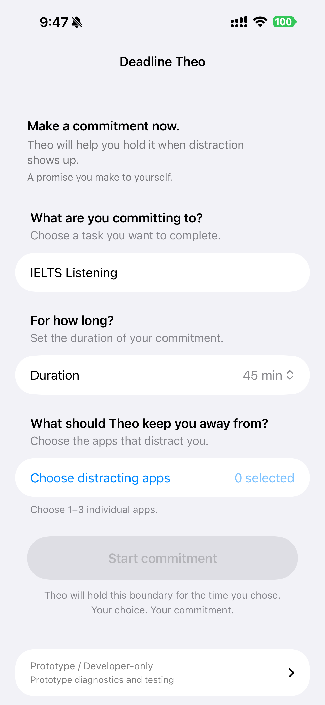
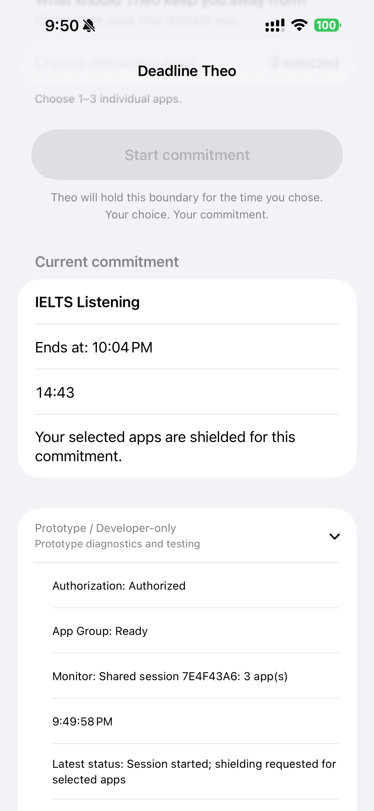
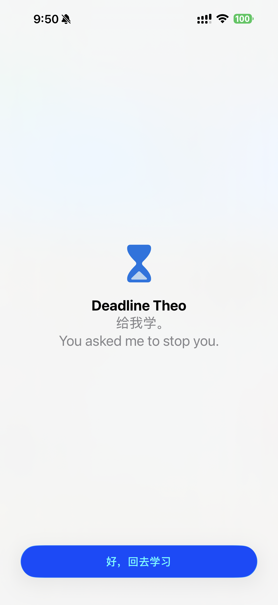

# DDL

**An iOS commitment tool for helping users follow through on decisions they made before distraction arrives.**

People often know what they want to do before distraction appears. The harder part is following through once a more tempting option becomes immediately available.

DDL explores a self-binding interaction model in which users define a commitment in advance — what they want to do, for how long, and which apps they want temporarily restricted — and deliberately grant the system limited authority to help enforce that earlier decision.

> DDL does not decide what the user should do.
> It helps enforce a commitment the user has already chosen.

---

## Why DDL?

Blocking an app is technically straightforward.

The more interesting question is **who decides when the restriction should happen, how long it should last, and how much authority the system should have once that decision has been made.**

DDL treats restriction not as a permanent rule imposed by software, but as a temporary commitment initiated by the user.

The authority comes from the user and is deliberately bounded.

---

## Design Principle — Revocable Authority

DDL is built around a design principle I call **Revocable Authority**:

> **Prior commitment has weight; present autonomy remains ultimate.**

This is a design framing used within DDL, rather than an established academic theory.

It has four core properties:

- **User-authored** — the commitment originates with the user. The system does not decide what the user should focus on.
- **Scoped** — authority applies only to the apps and duration explicitly selected by the user.
- **Time-bounded** — restrictions end automatically when the commitment expires.
- **Ultimately revocable** — the user must retain a meaningful way to withdraw the authority they previously granted.

This creates the central design tension behind DDL:

**How can an override remain genuinely available without making the original commitment meaningless?**

That question is still open.

---

## Interaction Model

DDL is organised around three moments:

**Commitment → Intervention → Release**

The current flow is:

`Define task → Choose duration → Select distracting apps → Start commitment → Restriction active → Intervention → Commitment persists → Automatic release`

### Commitment

The user defines:

- the task they want to complete;
- the duration of the commitment;
- the distracting apps they want temporarily restricted.

The system receives limited authority only after the user explicitly starts the commitment.

### Intervention

Once the commitment is active, selected apps are shielded at the system level.

If the user tries to open one of those apps, DDL does not ask them to make the decision again.

Instead, the intervention reminds them that the restriction comes from a choice they made earlier.

### Release

When the commitment expires, the restriction is removed automatically.

The user does not need to reopen DDL or confirm the release.

The authority ends with the commitment.

---

## Screenshots / Demo

| Commitment Setup | Active Commitment | Intervention / Shield |
| :---: | :---: | :---: |
|  |  |  |

Real screenshots from the working Prototype 0.1. The frozen interface retains its earlier on-screen label; DDL is the public project name. Images are reproduced without alteration.

---

## Prototype 0.1

DDL is currently an early but working iOS prototype.

Prototype 0.1 supports:

- task definition;
- commitment duration;
- distracting-app selection;
- starting an active commitment;
- system-level shielding for selected apps;
- restriction persistence when the main DDL app is terminated;
- restoration of an active commitment when DDL is reopened;
- automatic release when the commitment expires;
- unaffected access to apps that were not selected.

Current verified milestone:

`prototype-0.1-relaunch-verified`

---

## Implementation

Prototype 0.1 is built with native iOS frameworks:

- `SwiftUI`
- `FamilyControls`
- `ManagedSettings`
- `DeviceActivity`

`FamilyControls` handles user authorisation and app selection.

`ManagedSettings` applies the restriction and shield behaviour.

`DeviceActivity` allows the commitment lifecycle to persist independently of the main DDL process and supports cleanup when the session expires.

The current core commitment loop does not depend on a remote server or an AI model.

---

## Real-device Testing

The core interaction has been tested on a physical iPhone rather than only through build or simulator validation.

During a real 15-minute commitment session, relaunch testing exposed a repeatable lifecycle failure:

`Start → Shield active → terminate DDL → restriction remains → reopen DDL before expiry → session clears unexpectedly`

The restriction itself remained active after the main app was terminated, but reopening DDL could incorrectly trigger cleanup and end an active commitment early.

The issue was traced to startup state reconciliation. Different authorisation states were being collapsed too early into a Boolean value, allowing the app to interpret an incompletely restored state as unauthorised and clear the current session.

The fix was deliberately kept minimal rather than expanding the prototype into a broader state-machine redesign.

The repaired flow was then regression-tested:

`Start → Shield → terminate DDL → reopen → session persists → restriction persists → expiry → automatic release`

This failure became an important part of the project:

**a system working in build-time validation does not guarantee that it behaves correctly across the lifecycle of real use.**

---

## Current Limitations

DDL is still experimental and is not a finished consumer product.

### User-facing override

The current **Developer Reset** exists for development and testing only.

It is not the final user-facing revocation mechanism and should not be treated as a complete solution to Revocable Authority.

A future version needs to explore an override that remains accessible without reducing self-binding to a restriction that can be dismissed without friction.

### Product polish

The current interface is intentionally focused on the core commitment loop.

Full onboarding, accessibility, localisation, richer recovery states, and broader edge-case handling remain future work.

### Evaluation

Current validation focuses primarily on:

- the core interaction flow;
- real-device lifecycle behaviour;
- failure discovery and recovery;
- regression of the verified commitment loop.

Broader user evaluation has not yet been completed.

---

## Roadmap

### 0.1 — Core commitment loop

- commitment setup;
- distracting-app selection;
- system-level shielding;
- lifecycle persistence;
- relaunch recovery;
- automatic release.

### 0.2 — Revocation & Recovery

Future work will focus on:

- deliberate override interaction;
- the cost and friction of cancelling an active commitment;
- interrupted-session recovery;
- the practical boundary of Revocable Authority.

### Later

Once the core interaction is stable, possible areas for further development include:

- accessibility;
- system-language localisation;
- richer commitment feedback;
- broader formative evaluation;
- distribution and deployment.

DDL will not add features simply because they are technically possible.

A new capability should answer a more basic question:

**Does it make the relationship between the user and their earlier commitment clearer, more controllable, or more trustworthy?**

---

## Status

**Prototype 0.1 — working and verified on a physical iPhone**

Current verified tag:

`prototype-0.1-relaunch-verified`

DDL is experimental and actively evolving.
